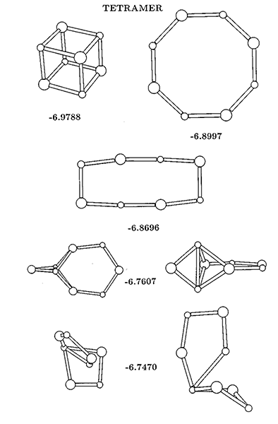
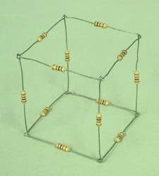

---
geometry:
- margin=1.25in
mainfont: Palatino
header-includes: 
- \usepackage[document]{ragged2e}
---

# Assignment 4

## Instructions
- PHY410 and PHY505: Do all problems (1, 2, and 3)

Accept the assignment from "Classroom 50" website: <https://classroom50.org/ubsuny/compphys-fall26/assignments/assignment-4/accept>. This will create a new repository for you on github, titled something like `github.com/ubsuny/compphys-fall26-assignment-4-username`. The repository is located in the `ubsuny` github group, but it is your personal repository, and only you can view it. (The repository is actually not a fork, but rather a brand new repository created by directly copying files from a "template repository.)

Like the previous assignment, you should upload your code to GitHub and a "lab report"/"write-up"-style document to UBLearns. I suggest that you use Markdown cells in the notebooks themselves and export the notebook to PDF/HTML/etc., rather than preparing a separate document (this might not always be possible, e.g., if you want to scan a handwritten document, feel free to do so). Like previous assignments, you can upload as many times as you like before the due date. 

You can use AI to help write code (it is not necessary, though). Any interpretations and explanations must be your own. Describe any use of AI in your answer. 

\newpage

## Problem 1: Classical scattering
*25 points*

This problem involves scattering trajectories and cross sections using the calculus tools covered in class. Please do your work in `problem1/problem1.ipynb`, which is provided in this repo. The C++ headers (`scattering.h` and its dependencies) from `CompPhys/Calculus` have been copied to `problem1/` for you, along with pybind11 bindings (`binding.cpp`) that expose the same python interface as the SWIG module used in class. (pybind11 is the more modern approach, and the one you should prefer in practice.)

### Problem 1a
*15 points*

Using the tools covered in class (specifically those used in `CompPhys/Calculus/scattering.ipynb`), study classical scattering from a hard sphere and from the Lennard–Jones potential. For both potentials:

1. Plot the potential and some typical trajectories. Choose a few values of energy ($E$), and make a separate plot for each value; for each plot, choose a range of impact parameters ($b$) to plot.
2. Compute and plot the differential scattering cross section versus $\theta_s$. Recall that the differential cross section is given by:

$$
\frac{d\sigma}{d\Omega} = \frac{b}{\sin\theta_s}\left\vert \frac{d\theta_s}{db}\right\vert^{-1}
$$

To compute $\frac{d\theta_s}{db}$, you will need to determine the scattering angle for different impact parameters, and then take the derivative numerically (using, for example, the five-point stencil method). 

### Problem 1b
*10 points*

For the Lennard–Jones potential, compute the trajectories for some values of the energy that demonstrate the phenomenon of orbiting. What is the maximum number of orbits that you can generate by carefully tuning the energy and impact parameter? 

---

\newpage

## Problem 2: Na$_4$Cl$_4$ clusters
*25 points*

Please do your work in `problem2/problem2.ipynb`. 

Determine the equilibrium configurations of $\rm{Na}_4\rm{Cl}_4$ clusters for tetramers ($n=4$) in this paper: K. Michaelian, "Evolving few-ion clusters of Na and Cl," Am. J. Phys. **66**, 231 (1998). The paper can be found in this repository (`problem2/michaelian1998.pdf`), and the configurations are copied below. Refer to the notebook from class (`CompPhys/MinMax/nacl.ipynb`) for guidance.

- Plot the equilibrium configurations using the macros from class (x,y,z in scatter plots). 
- Label them with their energies. 

Initialize them to an "ideal" case for the geometry, and allow the optimization to determine the final configurations.

{width=48%}

---

\newpage

## Problem 3: Resistor cube
*25 points*

{width=40%}

Please do your work in `problem3/problem3.ipynb`.

Write a program to solve for the currents in a resistor cube. There are 12 resistors, one along each edge. A voltage source is connected across a body diagonal of the cube. Refer to `CompPhys/LinearAlgebra/wheatstone.ipynb` for guidance. You might find it useful to draw the circuit in 2D (which you can do for a cube), instead of 3D.

In class, we set up the circuit equations with *loop analysis* (Kirchhoff's voltage law around loops, solving for the currents). If you are more familiar with *nodal analysis* (Kirchhoff's current law at each node, solving for the node voltages), feel free to use that instead. Either way, write the equations as a matrix equation and solve it with the linear algebra tools from class, and state which approach you used.

### Problem 3a
*10 points*

Using your program (i.e., using the linear algebra techniques covered in class, not just solving the problem directly!), find the equivalent resistance for the symmetric case when all the resistors have the same resistance, $R=1\,\Omega$. You might remember this problem from your E&M class.

### Problem 3b
*15 points*

Vary the resistance of one resistor at a time. How many unique cases are there? Plot the equivalent resistance as a function of the resistance of the one resistor being varied for all of the unique cases.

---
